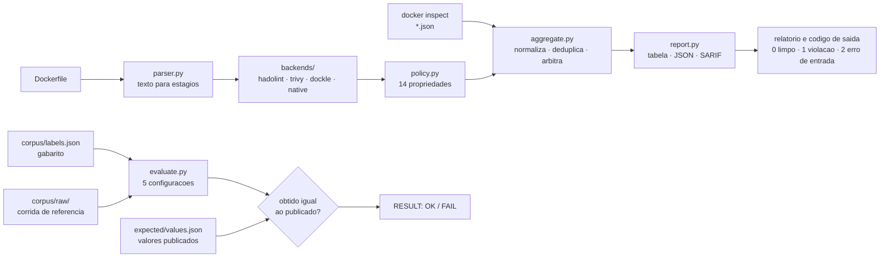

# dhaudit: auditoria de hardening de imagens Docker

`dhaudit` audita o hardening de imagens Docker orquestrando os scanners que já existem (hadolint, trivy e dockle), traduzindo a saída dos três para uma política única de 14 propriedades, e escrevendo código próprio somente nas lacunas medidas. Sobre um corpus rotulado de 24 Dockerfiles, hadolint responde a **4 das 12** propriedades de Dockerfile e o trivy a **6**; a união dos dois chega a **7**, com recall **0,593**. O agregado chega a **12 de 12**, com precisão **1,000** e recall **0,963**.

**Para a avaliação deste artefato, este README é o único arquivo que você precisa ler.** Os outros documentos são complementares: [`docs/ABOUT.md`](docs/ABOUT.md) traz o problema, a motivação e as limitações conhecidas, [`docs/USAGE.md`](docs/USAGE.md) os exemplos de uso e os formatos de saída, [`docs/COVERAGE.md`](docs/COVERAGE.md) a medição de cobertura que decidiu o desenho, e [`docs/DOCUMENTATION.md`](docs/DOCUMENTATION.md) a arquitetura módulo a módulo.

# Estrutura do readme.md



| Diretório ou arquivo | Conteúdo |
|---|---|
| `src/dhaudit/` | a ferramenta: `parser`, `policy`, `backends/`, `aggregate`, `evaluate`, `report`, `cli` |
| `corpus/dockerfiles/` | 23 Dockerfiles rotulados (14 com defeito, 9 corretos) |
| `corpus/dockerfiles_no_ignore/` | o caso de `.dockerignore` ausente, que exige diretório próprio |
| `corpus/image_configs/` | dois exemplos de `docker inspect`, um com defeito e um correto |
| `corpus/labels.json` | gabarito: as propriedades esperadas por arquivo |
| `corpus/raw/` | corrida de referência: saída bruta de hadolint e trivy |
| `expected/values.json` | os números publicados aqui, alvo da comparação |
| `scripts/` | `pull_backends`, `minimal_test`, `reproduce`, `collect_backends`, `dogfood`, `verify_all` |
| `tests/` | 68 testes, sem rede e sem docker |
| `docs/` | `ABOUT`, `USAGE`, `COVERAGE` e `DOCUMENTATION` |
| `Dockerfile` | imagem da ferramenta, auditada pela própria ferramenta |
| `.gitlab-ci.yml` | pipeline de testes e reprodução |

# Selos Considerados

Os selos considerados são: **Disponíveis**, **Funcionais**, **Sustentáveis** e **Reprodutíveis**.

- **Disponível.** Repositório público no GitLab, licença MIT, e este README com as seções mínimas.
- **Funcional.** O teste mínimo é um comando, roda sem rede e sem docker, e exercita o caminho real, não `--help`.
- **Sustentável.** Uma responsabilidade por módulo em `src/`, tipagem nas funções públicas, 68 testes sem rede, e `docs/DOCUMENTATION.md` explicando como acrescentar propriedade ou backend. O pipeline está declarado em `.gitlab-ci.yml` e roda os testes, o teste mínimo e a reprodução. Ele só é criado com a variável `DHAUDIT_CI=true`, porque nesta conta o GitLab responde `Identity verification is required in order to run CI jobs` (confirmado pelo lint oficial em modo `dry_run`) e um pipeline vermelho que nunca executou job é pior evidência do que nenhum. `./scripts/verify_all.sh` roda localmente o mesmo conjunto, em menos de um segundo.
- **Reprodutível.** `./scripts/reproduce.sh` recomputa a tabela publicada a partir da corrida de referência e compara valor por valor com `expected/values.json`, terminando em `RESULT: OK`.

# Informações básicas

Máquina de referência: AMD Ryzen 5 8600G, 32 GB de RAM, Ubuntu 24.04, Python 3.12.3, Docker 29.4.1. Não é preciso GPU.

| Modo | Requisitos | Disco (cumulativo) | Tempo |
|---|---|---|---|
| clone | git | 1,2 MB | ~2 s |
| teste mínimo e reprodução | Python 3.10 a 3.13 | 1,2 MB | 0,07 s e 0,04 s |
| suíte de testes | Python e pytest | 1,2 MB | 0,2 s |
| auditoria ao vivo | Docker e as três imagens | +287 MB de imagens, +3,1 MB de cache | ~2 min na primeira vez, ~25 s depois |

Disco e tempo medidos com `du -sh` e `/usr/bin/time` nesta máquina. As imagens saem com `docker image rm`.

# Dependências

A ferramenta não tem dependência de runtime: só a biblioteca padrão do Python.

| Dependência | Versão | Obrigatória |
|---|---|---|
| Python | 3.10 a 3.13 (testado em 3.12.3) | sim |
| pytest | 8.x | só para a suíte de testes |
| Docker | 20.10 ou mais novo (testado em 29.4.1) | só para o caminho ao vivo |

Os backends são imagens pinadas por digest, e o digest é verificado antes de cada execução:

| Backend | Imagem e digest |
|---|---|
| hadolint | `hadolint/hadolint:v2.15.1-alpine@sha256:a1d49ae1a4e83c1dbad26b8c1ad7588c8bd1e04f4866b34ad3cac50335198552` |
| trivy | `aquasec/trivy:0.74.0@sha256:62b1e65e8869bc4b4c6aa4fa2b21595256c7c2f6018a9d9ad61caf87187c1969` |
| dockle | `goodwithtech/dockle:v0.4.15@sha256:eade932f793742de0aa8755406c7677cd7696f8675b6180926f7eeffa7abe6b9` |

As versões foram conferidas contra as advisories de cada projeto em 8 de setembro de 2026. O trivy 0.74.0 está acima das correções de `GHSA-mcj4-mphf-j9ff`, `GHSA-q3fv-x8vg-qqm4` e `GHSA-8rc5-4fr6-64pw`, e fora da janela do comprometimento de março de 2026 (`GHSA-69fq-xp46-6x23` / CVE-2026-33634), cujas versões maliciosas o código recusa por nome.

# Preocupações com segurança

- A análise é estática e local: a ferramenta lê arquivos e roda contêineres de scanner; não constrói a imagem auditada nem executa nada dela.
- O contêiner do hadolint roda com `--network none`, e o do trivy também quando o cache de checks já está quente.
- Nenhuma credencial é necessária e nenhum dado sai da máquina. Os Dockerfiles do corpus apontam para hosts `*.invalid`, reservados pela RFC 2606, então nada neles resolve, e os segredos deles são valores de exemplo.
- O caminho `dhaudit image` monta `/var/run/docker.sock` no contêiner do dockle, o que equivale a dar acesso ao daemon. É opcional, e nenhum outro caminho precisa dele.

# Instalação

```bash
git clone https://gitlab.com/cristhianavila.aluno/docker-hardening-audit.git && cd docker-hardening-audit
```

Nada mais é preciso para o teste mínimo e para a reprodução: os scripts usam `PYTHONPATH=src` e só a biblioteca padrão. Para o caminho ao vivo, baixe as três imagens de backend (287 MB, ~2 min):

```bash
./scripts/pull_backends.sh
```

# Teste mínimo

Um comando, sem rede e sem docker, 0,07 s:

```bash
./scripts/minimal_test.sh
```

Ele audita um Dockerfile com defeito e um correto, e confere o código de saída dos dois. O começo da saída esperada:

```
=== 1. arquivo com defeito: corpus/dockerfiles/vuln_13_legacy_stack.Dockerfile
HARD-01  CRITICAL  corpus/dockerfiles/vuln_13_legacy_stack.Dockerfile:1  [native, trivy]
    The image does not run as root
      - native:NAT-USER line 1: the final stage never sets USER, so the image runs as the base image user
      - trivy:DS-0002 line 1: Image user should not be 'root'
    fix: create an unprivileged account and switch to it with `USER` in the final stage
```

e o fim:

```
=== 2. arquivo correto: corpus/dockerfiles/hardened_02_multistage.Dockerfile
dhaudit 1.0.0: 0 violation(s) in 1 file(s)
critical=0  high=0  medium=0  low=0
backends: hadolint (replay), trivy (replay), native
exit code: 0 (esperado 0: nenhuma violacao)

RESULT: OK
```

# Experimentos

## Reivindicação #1

**Descrição.** Sobre o corpus rotulado de 24 Dockerfiles, o agregado cobre 12 das 12 propriedades de Dockerfile com precisão 1,000 e recall 0,963, contra 7 propriedades e recall 0,593 da união de hadolint e trivy. É a reivindicação principal.

**Execução** (0,04 s, sem rede e sem docker):

```bash
./scripts/reproduce.sh
```

**Recursos esperados.** ~50 MB de RAM, nenhum disco adicional.

**Resultado esperado.** A tabela abaixo, recomputada a partir de `corpus/raw/`, seguida da comparação valor por valor com `expected/values.json` e de `RESULT: OK`.

```
configuration   TP  FP  FN  precision   recall     F1  properties
-----------------------------------------------------------------
hadolint         8   1  19      0.889    0.296  0.444           4
trivy           14   1  13      0.933    0.519  0.667           6
union           16   1  11      0.941    0.593  0.727           7
native          16   0  11      1.000    0.593  0.744           8
dhaudit         26   0   1      1.000    0.963  0.981          12
```

**Como ler a tabela.** A política foi definida depois de medir onde hadolint e trivy falham, e as checagens nativas foram escritas para as lacunas medidas. A comparação diz quanto de uma política explícita de hardening cada configuração cobre, e não que o agregado seja melhor que os scanners. O que ela sustenta é que rodar os dois e somar a saída deixa 5 das 12 propriedades sem resposta.

O único falso negativo é `vuln_15_heredoc_pipe.Dockerfile`, limitação declarada em [`docs/ABOUT.md`](docs/ABOUT.md): o `curl | sh` está dentro de um heredoc do BuildKit, que nenhuma configuração lê. O único falso positivo de hadolint e de trivy é o `ARG` sem valor default de `hardened_05`, removido pela arbitragem.

Para refazer a medição rodando os scanners de novo, em vez de reler a corrida de referência (~2 min, precisa de docker):

```bash
./scripts/reproduce.sh --live
```

## Reivindicação #2

**Descrição.** O `Dockerfile` deste repositório passa na auditoria da própria ferramenta, com os backends de verdade, sem violação MEDIUM ou acima.

**Execução** (~25 s, precisa de docker e das imagens de backend):

```bash
./scripts/dogfood.sh
```

**Recursos esperados.** 287 MB de disco para as imagens, ~300 MB de RAM.

**Resultado esperado.**

```
dhaudit 1.0.0: 0 violation(s) in 1 file(s)
critical=0  high=0  medium=0  low=0
backends: hadolint, trivy, native
out of policy: 1 backend finding(s) (hadolint:DL3066); see the json output for the detail
RESULT: OK (nenhuma violacao MEDIUM ou acima no proprio Dockerfile)
```

A única descoberta LOW no próprio Dockerfile é HARD-09, ausência de `HEALTHCHECK`, que não se aplica a uma imagem de CLI de execução única: não há serviço para sondar. Está declarado em comentário no Dockerfile, e é por isso que o comando roda com `--min-severity medium`.

## Reivindicação #3

**Descrição.** A verificação recusa backend cuja imagem local não corresponde ao digest pinado, e recusa por nome as versões comprometidas de março de 2026, sem precisar de rede.

**Execução** (0,02 s):

```bash
PYTHONPATH=src python3 -m pytest tests/test_backends.py tests/test_policy.py -v
```

**Recursos esperados.** ~50 MB de RAM.

**Resultado esperado.** 9 testes passando, entre eles `test_a_compromised_version_is_refused_before_docker_is_touched` e `test_no_pinned_backend_is_a_known_compromised_release`. Para ver a verificação contra o estado real da máquina:

```bash
PYTHONPATH=src python3 -m dhaudit.cli backends
```

# LICENSE

MIT. Ver [`LICENSE`](LICENSE).
