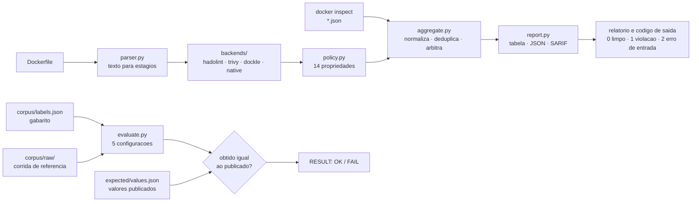

# dhaudit: auditoria de hardening de imagens Docker

`dhaudit` é uma ferramenta de linha de comando que responde a uma pergunta só: **esta imagem Docker está endurecida?** Hoje, responder isso exige rodar três scanners diferentes (hadolint, trivy e dockle), ler três formatos de saída, traduzir três vocabulários de severidade, e descobrir na prática que dois deles reportam a mesma coisa em duplicidade, que um deles acusa como segredo um `ARG` que não vaza nada, e que nenhum deles verifica se existe `.dockerignore`. O `dhaudit` não reimplementa esses scanners: ele os **orquestra** a partir de imagens pinadas por digest e verificadas antes de executar, traduz o que cada um diz para uma **política única de 14 propriedades de hardening** (não-root, base pinada por digest, sem segredo em `ENV`, sem `curl | sh`, sem `ADD` remoto, sem permissão 777, entre outras), deduplica a mesma propriedade reportada por fontes diferentes mantendo a evidência de cada uma, remove um falso positivo conhecido, e implementa código próprio **somente nas sete lacunas que uma medição mostrou existir**. O resultado é um relatório único, com código de saída para pipeline, em tabela, JSON ou SARIF. Sobre um corpus rotulado de 24 Dockerfiles, hadolint responde a **4 das 12** propriedades de Dockerfile e o trivy a **6**; a união dos dois chega a **7**, com recall **0,593** e um falso positivo. O agregado chega a **12 de 12**, com precisão **1,000** e recall **0,963**.

Para a avaliação deste artefato, este README é o único arquivo necessário; os demais documentos são complementares e estão linkados em [Estrutura do readme.md](#estrutura-do-readmemd).

O caminho de uma execução, e onde cada diretório do repositório entra nele:



# Estrutura do readme.md

| Seção | Descrição |
|---|---|
| [Estrutura do readme.md](#estrutura-do-readmemd) | esta tabela, e os documentos complementares |
| [Selos Considerados](#selos-considerados) | quais selos o artefato pleiteia, e por que cada um se sustenta |
| [Informações básicas](#informações-básicas) | máquina de referência, requisitos por modo, disco e tempo medidos |
| [Dependências](#dependências) | versões exatas, digests dos backends e a auditoria de advisories |
| [Preocupações com segurança](#preocupações-com-segurança) | o que a execução faz na máquina do avaliador |
| [Instalação](#instalação) | um comando; o caminho ao vivo pede um segundo |
| [Teste mínimo](#teste-mínimo) | um comando, com a saída esperada literal |
| [Experimentos](#experimentos) | as três reivindicações, uma subseção cada |
| [LICENSE](#license) | MIT |

Documentos complementares, nenhum necessário para a avaliação: [`docs/ABOUT.md`](docs/ABOUT.md) traz problema, motivação e limitações conhecidas; [`docs/USAGE.md`](docs/USAGE.md) os exemplos de uso, formatos de saída e códigos de saída; [`docs/COVERAGE.md`](docs/COVERAGE.md) a medição de cobertura que decidiu o desenho; [`docs/DOCUMENTATION.md`](docs/DOCUMENTATION.md) a arquitetura, a árvore do repositório e como estender.

# Selos Considerados

Os selos considerados são: **Disponíveis**, **Funcionais**, **Sustentáveis** e **Reprodutíveis**.

- **Disponível.** Repositório público no GitLab, licença [MIT](LICENSE), e este README com as seções mínimas exigidas.
- **Funcional.** O [teste mínimo](#teste-mínimo) é um comando, roda sem rede e sem docker, e exercita o caminho real (parser, backends, política, arbitragem, relatório e código de saída), não `--help`.
- **Sustentável.** Uma responsabilidade por módulo em [`src/dhaudit/`](src/dhaudit), tipagem nas funções públicas, docstring por módulo dizendo qual decisão ele carrega, 68 testes sem rede, e [`docs/DOCUMENTATION.md`](docs/DOCUMENTATION.md) explicando como acrescentar propriedade ou backend. O pipeline está declarado em [`.gitlab-ci.yml`](.gitlab-ci.yml) e é válido pelo `ci/lint` oficial, mas o CI/CD está desligado nas configurações do projeto: esta conta não tem verificação de identidade e o GitLab responde `Identity verification is required in order to run CI jobs`, situação em que todo push cria um pipeline e o falha sem executar job. Um pipeline vermelho que nunca rodou é pior evidência do que nenhuma. [`scripts/verify_all.sh`](scripts/verify_all.sh) roda localmente o mesmo conjunto, em menos de um segundo.
- **Reprodutível.** [`scripts/reproduce.sh`](scripts/reproduce.sh) recomputa a tabela publicada a partir da corrida de referência versionada em [`corpus/raw/`](corpus/raw) e compara valor por valor com [`expected/values.json`](expected/values.json), imprimindo `obtido · esperado · ok` por valor e terminando em `RESULT: OK`, com saída não-zero em qualquer divergência.

# Informações básicas

Máquina de referência de todas as medidas: AMD Ryzen 5 8600G (6 núcleos), 32 GB de RAM, Ubuntu 24.04, kernel 7.0.0-31-generic, Python 3.12.3, Docker 29.4.1. Não é preciso GPU, e nenhum caminho exige root na máquina do avaliador.

| Modo | Requisitos | Disco (cumulativo) | Tempo medido |
|---|---|---|---|
| clone do repositório | git | 1,2 MB | ~2 s |
| teste mínimo | Python 3.10 a 3.13 | 1,2 MB | 0,07 s |
| reprodução da Reivindicação #1 | Python 3.10 a 3.13 | 1,2 MB | 0,04 s |
| suíte de testes | Python e pytest | 1,2 MB | 0,2 s |
| auditoria ao vivo e Reivindicação #2 | Docker e as três imagens de backend | +287 MB de imagens, +3,1 MB de cache do trivy | ~2 min na primeira vez, ~25 s depois |

Disco medido com `du -sh` e tempo com `/usr/bin/time` nesta máquina; nenhum valor é estimado. As imagens de backend saem com `docker image rm`, e o cache do trivy com `rm -rf ~/.cache/dhaudit-trivy`. Numa máquina mais lenta, os três primeiros modos continuam abaixo de um segundo, porque leem 24 arquivos de texto; o que varia é o caminho ao vivo, dominado pelo download das imagens.

# Dependências

A ferramenta não tem dependência de runtime: apenas a biblioteca padrão do Python. Não há `requirements.txt` a instalar para o teste mínimo nem para a reprodução.

| Dependência | Versão | Para quê | Obrigatória |
|---|---|---|---|
| Python | 3.10 a 3.13 (medido em 3.12.3) | rodar a ferramenta | sim |
| pytest | 8.x (`pip install '.[dev]'`) | rodar a suíte de testes | só para os testes |
| Docker | 20.10 ou mais novo (medido em 29.4.1) | rodar os backends ao vivo | só no caminho ao vivo |

Os backends são imagens pinadas por digest, obtidas por [`scripts/pull_backends.sh`](scripts/pull_backends.sh), e o digest é verificado antes de cada execução:

| Backend | Imagem e digest |
|---|---|
| hadolint | `hadolint/hadolint:v2.15.1-alpine@sha256:a1d49ae1a4e83c1dbad26b8c1ad7588c8bd1e04f4866b34ad3cac50335198552` |
| trivy | `aquasec/trivy:0.74.0@sha256:62b1e65e8869bc4b4c6aa4fa2b21595256c7c2f6018a9d9ad61caf87187c1969` |
| dockle | `goodwithtech/dockle:v0.4.15@sha256:eade932f793742de0aa8755406c7677cd7696f8675b6180926f7eeffa7abe6b9` |

As versões foram conferidas contra as advisories de cada projeto em 8 de setembro de 2026. O trivy 0.74.0 está acima das correções de `GHSA-mcj4-mphf-j9ff` (0.71.1), `GHSA-q3fv-x8vg-qqm4` (0.71.0) e `GHSA-8rc5-4fr6-64pw` (0.72.0), e fora da janela do comprometimento de março de 2026 (`GHSA-69fq-xp46-6x23` / CVE-2026-33634), cujas versões maliciosas (0.69.4, 0.69.5 e 0.69.6) o código recusa por nome em `backends.KNOWN_COMPROMISED`. hadolint e dockle não têm advisory publicada.

Puxar imagem por digest a guarda **sem tag**, então ela não aparece em `docker images`. Quem confirma que os três backends estão presentes e conferem é `dhaudit backends`.

# Preocupações com segurança

- A análise é estática e local: a ferramenta lê arquivos e roda contêineres de scanner. Ela não constrói a imagem auditada nem executa nada de dentro dela.
- O contêiner do hadolint roda com `--network none`. O do trivy também, quando o cache de checks já está quente; com cache frio ele precisa de rede uma vez para baixar o pacote de políticas, e o script avisa.
- Nenhuma credencial é necessária e nenhum dado sai da máquina.
- Os Dockerfiles do corpus apontam para hosts `*.invalid`, reservados pela RFC 2606, então nada neles resolve mesmo se algo for executado por engano. Os segredos deles são valores de exemplo (`hunter2-prod`, `ghp_exampletokenvalue123456`), não credenciais reais.
- O caminho opcional `dhaudit image` monta `/var/run/docker.sock` no contêiner do dockle, o que equivale a dar controle do daemon do host àquele contêiner. Nenhum outro caminho precisa disso, e o teste mínimo e as três reivindicações não usam esse comando.

# Instalação

```bash
git clone https://gitlab.com/cristhianavila.aluno/docker-hardening-audit.git && cd docker-hardening-audit
```

É tudo o que o teste mínimo e a reprodução precisam: os scripts usam `PYTHONPATH=src` e só a biblioteca padrão, sem ambiente virtual e sem instalar pacote. Para o caminho ao vivo, baixe as três imagens de backend (287 MB, ~2 min):

```bash
./scripts/pull_backends.sh
```

# Teste mínimo

Um comando, sem rede e sem docker, 0,07 s:

```bash
./scripts/minimal_test.sh
```

Ele audita um Dockerfile com defeito e um correto, lendo a saída de backend versionada em [`corpus/raw/`](corpus/raw), e confere o código de saída dos dois. O começo da saída esperada:

```
=== 1. arquivo com defeito: corpus/dockerfiles/vuln_13_legacy_stack.Dockerfile
HARD-01  CRITICAL  corpus/dockerfiles/vuln_13_legacy_stack.Dockerfile:1  [native, trivy]
    The image does not run as root
      - native:NAT-USER line 1: the final stage never sets USER, so the image runs as the base image user
      - trivy:DS-0002 line 1: Image user should not be 'root'
    fix: create an unprivileged account and switch to it with `USER` in the final stage
```

e o fim:

```
=== 2. arquivo correto: corpus/dockerfiles/hardened_02_multistage.Dockerfile
dhaudit 1.0.0: 0 violation(s) in 1 file(s)
critical=0  high=0  medium=0  low=0
backends: hadolint (replay), trivy (replay), native
exit code: 0 (esperado 0: nenhuma violacao)

RESULT: OK
```

# Experimentos

## Reivindicação #1: o agregado cobre 12 das 12 propriedades de Dockerfile, com precisão 1,000 e recall 0,963, contra 7 propriedades e recall 0,593 da união de hadolint e trivy

É a reivindicação principal.

**Execução** (0,04 s, sem rede e sem docker):

```bash
./scripts/reproduce.sh
```

**Recursos esperados.** ~50 MB de RAM, nenhum disco adicional.

**Resultado esperado.** A tabela abaixo, recomputada a partir de [`corpus/raw/`](corpus/raw), seguida da comparação valor por valor com [`expected/values.json`](expected/values.json) e de `RESULT: OK`.

```
configuration   TP  FP  FN  precision   recall     F1  properties
-----------------------------------------------------------------
hadolint         8   1  19      0.889    0.296  0.444           4
trivy           14   1  13      0.933    0.519  0.667           6
union           16   1  11      0.941    0.593  0.727           7
native          16   0  11      1.000    0.593  0.744           8
dhaudit         26   0   1      1.000    0.963  0.981          12
```

**O que a reivindicação afirma, e onde a ferramenta é pior.** A política de 14 propriedades foi definida depois de medir onde hadolint e trivy falham, e as checagens nativas foram escritas para as lacunas medidas: a comparação diz quanto de uma política explícita de hardening cada configuração cobre, e não que o agregado seja melhor que os scanners em geral. O que ela sustenta é que rodar os dois e somar a saída deixa 5 das 12 propriedades sem resposta. Contra a própria ferramenta: ela não lê heredoc do BuildKit, e o `curl | sh` de `vuln_15_heredoc_pipe.Dockerfile` passa por ela como passa pelos dois backends, o que é o único falso negativo da tabela; ela também não resolve variável nem `eval`, então `RUN $INSTALL` esconde qualquer comando. As duas limitações estão em [`docs/ABOUT.md`](docs/ABOUT.md). O único falso positivo de hadolint e de trivy é o `ARG` sem valor default de `hardened_05_arg_without_default.Dockerfile`, que a arbitragem remove imprimindo a razão.

Para refazer a medição rodando os scanners de novo, em vez de reler a corrida de referência (~2 min, precisa de docker e das imagens):

```bash
./scripts/reproduce.sh --live
```

## Reivindicação #2: o Dockerfile deste repositório passa na auditoria da própria ferramenta, sem violação MEDIUM ou acima

**Execução** (~25 s, precisa de docker e das imagens de backend):

```bash
./scripts/dogfood.sh
```

**Recursos esperados.** 287 MB de disco para as imagens, ~300 MB de RAM.

**Resultado esperado.**

```
dhaudit 1.0.0: 0 violation(s) in 1 file(s)
critical=0  high=0  medium=0  low=0
backends: hadolint, trivy, native
out of policy: 1 backend finding(s) (hadolint:DL3066); see the json output for the detail
RESULT: OK (nenhuma violacao MEDIUM ou acima no proprio Dockerfile)
```

**O que a reivindicação afirma, e onde a ferramenta é pior.** O [`Dockerfile`](Dockerfile) satisfaz as próprias regras: base pinada por digest, usuário não-root, sem segredo, sem download executado, sem permissão permissiva. O limiar é MEDIUM e não LOW por um motivo declarado: a ferramenta acusa HARD-09 (ausência de `HEALTHCHECK`) no próprio Dockerfile, e essa propriedade não se aplica a uma imagem de CLI de execução única, porque não há serviço para sondar. Escrever um `HEALTHCHECK` inútil só para o próprio linter ficar verde seria falsear o resultado, então a exceção está em comentário no Dockerfile e o comando roda com `--min-severity medium`.

## Reivindicação #3: a verificação recusa backend com digest divergente e recusa por nome as versões comprometidas de março de 2026, sem precisar de rede

**Execução** (0,02 s, sem rede e sem docker):

```bash
PYTHONPATH=src python3 -m pytest tests/test_backends.py tests/test_policy.py -q
```

**Recursos esperados.** ~50 MB de RAM.

**Resultado esperado.** `9 passed`, entre eles `test_a_compromised_version_is_refused_before_docker_is_touched`, que substitui o digest pinado por uma versão maliciosa e confere que a recusa acontece antes de o docker ser chamado, e `test_no_pinned_backend_is_a_known_compromised_release`.

**O que a reivindicação afirma, e onde a ferramenta é pior.** A verificação compara o digest da imagem local com o pinado, e não a tag: tag conferida não prova conteúdo, e foi tag forçada que o atacante usou em março de 2026. O que ela não faz é atestação criptográfica de procedência: se a imagem maliciosa tivesse sido publicada com o digest que este repositório pina, a verificação passaria. Ela protege contra tag mutável e cache envenenado, não contra um digest escolhido pelo atacante e copiado para cá.

Para ver a verificação contra o estado real da máquina:

```bash
PYTHONPATH=src python3 -m dhaudit.cli backends
```

# LICENSE

MIT. Ver [`LICENSE`](LICENSE).
